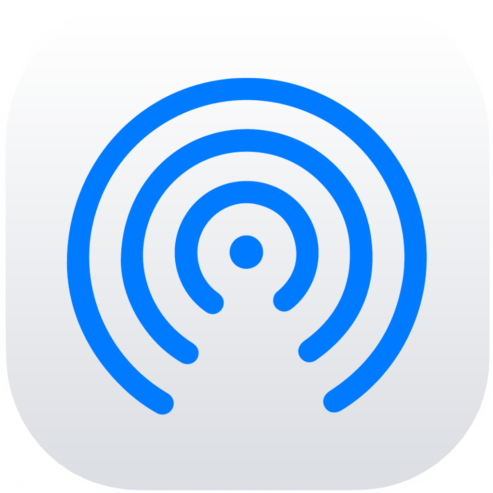
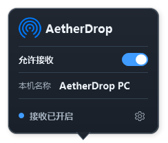
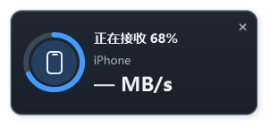

<p align="center">
  
</p>

<h1 align="center">AetherDrop</h1>

<p align="center">
  用受支持的无线网卡，在 Windows 上收发苹果设备的隔空投送。<br>
  统一的深浅色界面、托盘操作和传输状态卡片。
</p>

**AetherDrop 基于原作者 [zheznanohana](https://github.com/zheznanohana) 的 [nekodrop](https://github.com/zheznanohana/nekodrop) 项目修改，修改基线版本为 0.1.35。** 原作者及上游贡献者完成了底层驱动、无线通信、隔空投送和服务管理等核心工作。本项目主要调整品牌、界面、交互和分发方式，保留上游署名及开源许可。

**当前版本：0.1.35** · [下载 AetherDrop](https://github.com/chenzihao0729/AetherDrop/releases) · [网卡兼容性](docs/COMPATIBILITY.zh-CN.md) · [上游版本记录](CHANGELOG.md) · [许可](LICENSE)

## 界面预览

| 托盘弹窗 | 接收邀请 | 传输进度 |
|---|---|---|
|  |  |  |

## 功能与兼容性

依赖 Windows 原生无线网卡接口的软件（如部分无线调试或投屏工具）可能需要切换到“按需接管网卡”模式。

可接收 iPhone、iPad、Mac 发来的文件，也可从资源管理器右键选择 **用 AetherDrop 发送**，或在主界面添加、拖入文件后选择附近设备。

无线传输依赖受支持的硬件，并非所有无线网卡都可用。Intel 部分型号支持同时连接 Wi-Fi 和隔空投送，其他模式可能短暂接管网卡。具体型号、限制和上游实测记录见[网卡兼容性文档](docs/COMPATIBILITY.zh-CN.md)。上游的硬件与性能记录不代表本衍生版本已在所有型号上重新验证。

苹果设备上请将隔空投送设为 **所有人（10 分钟）**。“仅限联系人”依赖 Apple ID 身份，当前方案不支持。

## 下载与版本

当前 AetherDrop 安装包为 **0.1.35**，文件名为 `AetherDrop-0.1.35-setup.exe`。

- **本项目下载：** [AetherDrop Releases](https://github.com/chenzihao0729/AetherDrop/releases)。
- **原项目发布：** [nekodrop Releases](https://github.com/zheznanohana/nekodrop/releases)，修改基线为 **0.1.35**。

`CHANGELOG.md` 保留上游历史，其中可能包含后续版本记录，不代表本项目已发布该版本。

## 安装与使用

1. 使用发布的 `AetherDrop-0.1.35-setup.exe` 安装包，按提示授予管理员权限。
2. 默认安装位置为 `C:\Program Files\AetherDrop`，安装程序配置所需服务、驱动和防火墙规则。
3. 启动后通过托盘图标开启接收。可在设置页修改设备名称、接收目录和联网方式。
4. 从苹果设备发起隔空投送，或在 Windows 中右键文件选择 **用 AetherDrop 发送**。

安装包包含 .NET 8 x64 运行库、Python 引擎及所需组件。分发清单排除测试程序、截图、日志和调试符号。[运行库打包说明](docs/BUNDLED-RUNTIME.md)。

底层兼容名称仍可能使用 `NekoDropService`、`nekodrop` 网卡和协议标识。这些是运行接口，不是界面中的旧品牌残留。

## 卸载与恢复

在 Windows 的“设置 → 应用”中卸载 **AetherDrop**，或以管理员身份运行安装目录里的 `uninstall.ps1`。卸载会尝试先归还无线网卡，再清理应用服务、驱动包、证书和防火墙规则；接收到的文件保留。

需要先检查而不卸载时：

```powershell
.\uninstall.ps1 -SelfTest
.\uninstall.ps1 -DryRun -Target 'C:\Program Files\AetherDrop'
```

若网卡未恢复，可使用安装目录的 `restore.cmd`。恢复、诊断与卸载脚本可能请求管理员权限。详细说明见[卸载检查](docs/UNINSTALL-CHECK.md)。

## 日志与问题排查

托盘菜单或主界面的 **生成诊断报告** 用于导出排查信息。内部日志沿用上游路径：

| 路径 | 内容 |
|---|---|
| `C:\ProgramData\nekodrop\service.log` | 服务、无线驱动、Wi-Fi 和 AWDL 日志 |
| `%LOCALAPPDATA%\nekodrop\engine.log` | 设备发现、接收和发送日志 |
| `C:\ProgramData\nekodrop\install.log` | 安装过程 |
| `C:\ProgramData\nekodrop-uninstall.log` | 卸载结果与失败步骤 |

## 源码开发

在本源码目录中启用本地开发环境并构建：

```powershell
. .\scripts\dev-env.ps1
dotnet build .\app\client\NekoDrop.csproj -c Debug
```

- **离线界面调试**：运行根目录的 `UI调试.cmd`，使用模拟事件预览，不启动真实无线服务。
- **真实运行**：运行构建后的 `AetherDrop.exe`，需要已安装并可用的服务与驱动。
- **构建安装包**：运行 `scripts/build-installer.ps1`，输出位于 `build/`；需要 C++、Windows SDK/WDK 及相应构建依赖。
- [界面调试说明](docs/UI-DEBUG.md) · [外观配色](docs/APPEARANCE.md) · [字体说明](docs/TYPOGRAPHY.md) · [品牌与图标](docs/BRANDING.md)

## 原作者与上游项目

- **原作者：** [zheznanohana](https://github.com/zheznanohana)
- **原项目：** [zheznanohana/nekodrop](https://github.com/zheznanohana/nekodrop)
- **修改基线：** 0.1.35

以下保留上游对源码来源、原创工作和贡献者的说明。底层能力来自原作者及相关开源项目，AetherDrop 的界面修改不改变其归属。

### 用到的源码

| 项目 | 许可 | 用了什么 | 在项目中的位置 |
|---|---|---|---|
| [retropineaple/ForbiddenItlwm](https://github.com/retropineaple/ForbiddenItlwm) 0.6.0（itlwm 分支，macOS） | GPL-2.0 | Intel 22000 系列驱动 `hal_iwx`：固件加载、TLV 解析、context info、收发环、固件命令、寄存器头文件 `if_iwxreg.h`。还有它的 AWDL 策略：信道跟随（44/149 的 min 规则、国家码学习）、接收 Block Ack、BA 期间关混杂、速率阶梯、主机侧单播重发、信标提示 | `iwxradio/`，从内核 C 移植成用户态 C++ 驱动 |
| ForbiddenItlwm 的固件目录 | Intel 再分发许可 | iwlwifi 固件 `iwlwifi-Qu*-hr-b0-68.ucode` | 随安装包放在 `radio\firmware\` |
| [raph559/winawdl](https://github.com/raph559/winawdl) | MIT / GPL-2.0（`radio/`） | 在 Windows 上从用户态接管 PCIe 网卡的方法：UMDF 寄存器代理驱动、用户态 DMA、radio 管道协议，以及 RTL8852CE radio 守护进程（`radio/`） | `driver/regproxy/`（支持 Intel 与 RTL8852CE 的 PCI ID）、`iwxradio/`（管道和 DMA）、`radio\nekodrop-radio-rtl.exe` |
| [raph559/devourer](https://github.com/raph559/devourer)（`winawdl/pcie-windows`） | GPL-2.0 | Realtek RTL8852CE 用户态 PCIe 驱动（`KESTREL_8852C`，内嵌固件与双向 A-MPDU 栈） | 编译打包为 `radio\nekodrop-radio-rtl.exe`（`licenses\devourer-GPL-2.0.txt`） |
| winawdl 的 `awdl/`（`awdld`） | GPL-3.0 或更新（基于 OWL） | AWDL 守护进程：OWL 的协议核心加上 Windows I/O 层和 Wintun | 从源码编译，随安装包放在 `awdl\awdld.exe` |
| winawdl 的 `airdrop/` | MIT | Python 写的 AirDrop 引擎：mDNS、HTTPS 接收端、发送端、蓝牙信标 | 放在 `airdrop\`，打了两个小补丁（`scripts/patch-engine.py`：固定实例名、备用端口） |
| [seemoo-lab/owl](https://github.com/seemoo-lab/owl) | GPL-3.0 | `awdld` 里的 AWDL 实现 | 经由 winawdl |
| [Wintun](https://www.wintun.net/) | Wintun 许可 | 虚拟网卡 `awdl0` | `awdl\wintun.dll`（预编译） |
| [TAP-Windows6](https://github.com/OpenVPN/tap-windows6) | GPL-2.0 / OpenVPN | Windows 上网用的“nekodrop”虚拟以太网卡 | 安装时装上（OpenVPN 签名的安装程序） |

### 参考过的项目（没有复制代码）

| 项目 | 参考了什么 |
|---|---|
| OpenBSD `iwx(4)`、Linux `iwlwifi` | 固件、UMAC 扫描、站点模式、密钥的工作方式 |
| [seemoo-lab/opendrop](https://github.com/seemoo-lab/opendrop) | AirDrop 协议（`/Discover`、`/Ask`、`/Upload`、mDNS 记录） |
| [microsoft/Windows-driver-samples](https://github.com/microsoft/Windows-driver-samples) | 已搁置的内核驱动（`kdriver/`）的 WiFiCx 结构 |
| [t4t5/owly](https://github.com/t4t5/owly)、[JungyoKim/WirDrop](https://github.com/JungyoKim/WirDrop) | 其他平台上实现 AirDrop 的尝试，设计时对比参考 |

### 上游 nekodrop 的原创工作

- `iwxradio/`：用户态移植本身，以及所有 Windows 特有的部分：两个 MAC 同时运行（AWDL 监听加上独立 PHY 上的 Wi-Fi 站点）、WPA2 站点模式（四次握手、密钥交给固件、TLC 速率控制）、TAP 桥接、固件 UMAC 扫描、信标解析和加密方式识别。
- `app/service/`：Windows 服务：网卡接管、radio 和 awdld 监管、Wi-Fi 管理（DPAPI 加密保存的网络、自动连接、隐藏网络、网页登录识别）。
- `app/client/`：托盘程序（WPF）、通知、发送窗口、Wi-Fi 窗口、中英文界面。
- `app/shellext/`：Windows 11 右键菜单。
- `installer/`：Inno Setup 安装包、本机驱动签名、TAP 配置和卸载。

## 上游贡献者

以下致谢沿用上游记录，感谢为原项目提交代码和测试报告的贡献者：

- [@BaiBaiAi](https://github.com/BaiBaiAi)：Windows → iPhone 发送不再出示客户端证书（[#13](https://github.com/zheznanohana/nekodrop/pull/13)）、AWDL 发送流水线化让大文件能传完（[#15](https://github.com/zheznanohana/nekodrop/pull/15)），以及第一份 AX210 实测报告（[#14](https://github.com/zheznanohana/nekodrop/issues/14)）。
- [@XXD051030](https://github.com/XXD051030)：Intel 网卡可选的蓝牙均衡共存模式，让电脑几秒内就能找到 iPhone 和 Mac，而不是等一两分钟，并附了一份 AX200 上的详细前后对照（[#26](https://github.com/zheznanohana/nekodrop/pull/26)）。
- [@GGBond-cer](https://github.com/GGBond-cer)：大量详细的 AX200 实测报告，帮我们定位了 A-MPDU 和速度问题（[#4](https://github.com/zheznanohana/nekodrop/issues/4)），找到了卸载残留的根因（[#22](https://github.com/zheznanohana/nekodrop/issues/22)），并写了传输速度测试指南（[#28](https://github.com/zheznanohana/nekodrop/pull/28)）。

## 许可

AetherDrop 基于 nekodrop，沿用 **GPL-2.0** 许可。上游整体以 **GPL-2.0** 发布（见 [LICENSE](LICENSE)），因为 `iwxradio/` 派生自 itlwm/ForbiddenItlwm。

- `if_iwxreg.h`：BSD/GPL-2.0 双许可。
- `driver/regproxy` 和 AirDrop 引擎：沿用 winawdl 的 MIT 许可。
- `nekodrop-radio-rtl.exe`（`raph559/winawdl` `radio/` + `raph559/devourer`）：GPL-2.0（`licenses\devourer-GPL-2.0.txt`）。
- `awdld`：GPL-3.0 或更新，来自 winawdl/OWL，是通过管道通信的独立程序。
- iwlwifi 固件：Intel 再分发许可（`licenses\iwlwifi-firmware.txt`）。
- Wintun 和 TAP-Windows：各按其许可。

安装包会把所有许可证复制到 `licenses\`。

## 免责声明

AetherDrop 是基于 nekodrop 修改的独立衍生项目，与 Apple、Intel 没有任何关系，也未获得它们的认可。AirDrop、iPhone、iPad、Mac 是 Apple Inc. 的商标，Intel 是 Intel Corporation 的商标。AetherDrop 运行期间会替换你的 Wi-Fi 驱动。这是实验性软件，按原样提供，不附带任何担保。
